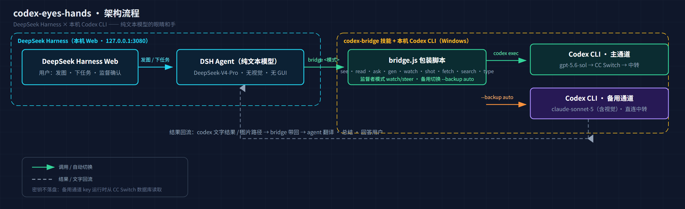
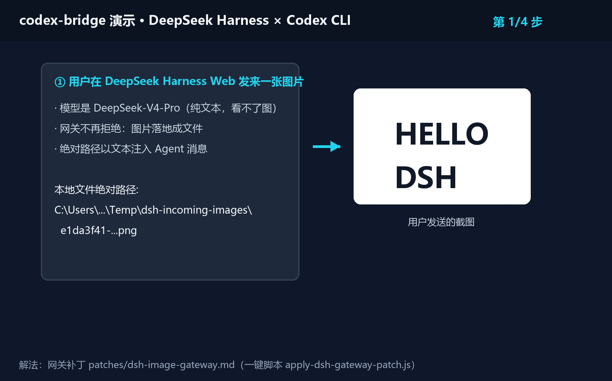
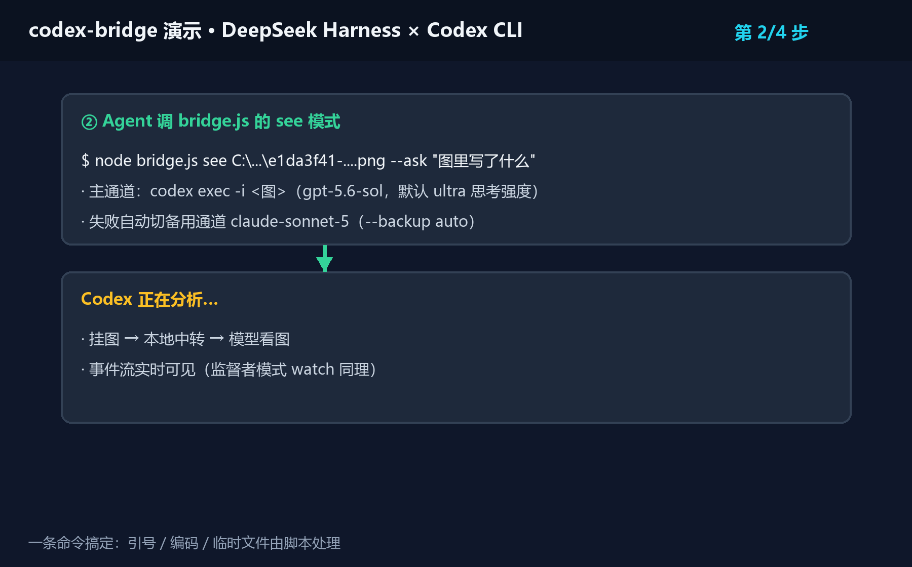
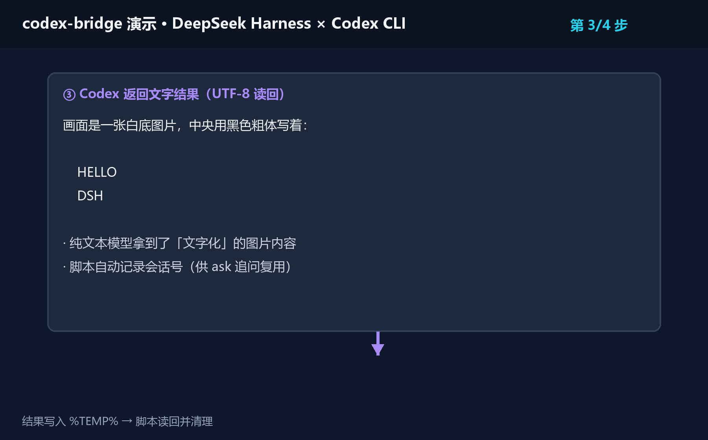
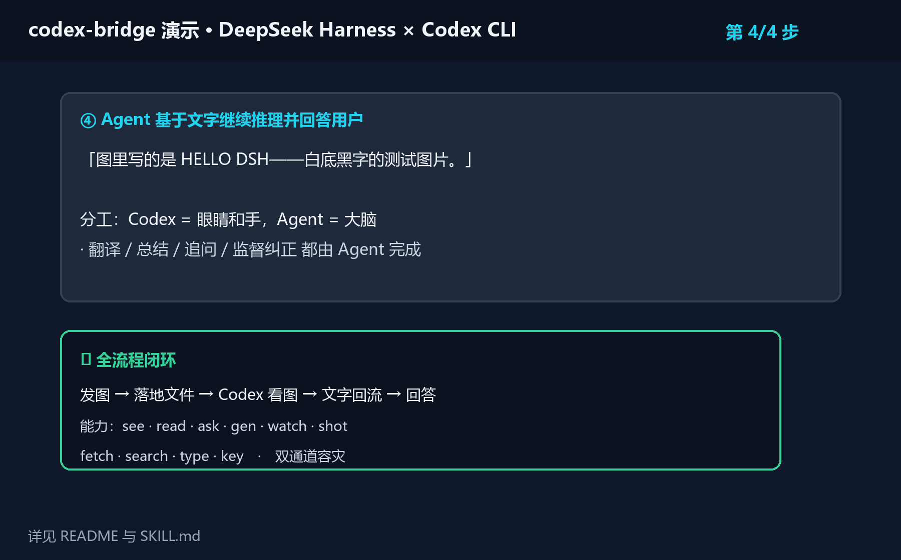

# codex-eyes-hands v2.4 · 单包 DSH 插件

> **v2.4.0**：图片消息保留原生附件和原话，后台识图，状态与完整详情分开展示；长OCR默认不进入主模型上下文。只在文本模型缺少视觉时调用已有Codex，可能产生模型用量。

> **v2.3.0**：左侧独立页面，不占聊天输入区；保留Codex识图、执行与插件内上游提醒。终端、会话搜索、Forge和自动标题完全由DSH官方管理，本插件不再内置或接管。

> **v2.1.0**：新增纯视觉识别缓存、结构化结果、裁剪放大、长图分块、像素对比和可选本地 OCR；一个插件，不自动装模型/引擎。新入口和隐私说明见 [使用说明](docs/PLUGIN.md)。41项离线测试通过；不代表真实视觉与桌面已验收。

现在提供一个可安装的 DSH bundle：复用官方 Codex 子智能体实现，使用你已有的 Codex，不要求额外安装官方 Codex 插件或整套电脑插件。新增 /codex 附件交接、codex_task 委派、超时和安全失败处理；保留旧 CLI。

请先阅读 [v2 安装、权限与验收限制](docs/PLUGIN.md)。版本 2.0.0 目前完成离线测试；不要把下方旧版的历史“实测通过”标记当作本次端到端验收。

## 旧版 v1.2.1 文档（兼容参考，非 v2 默认后端）

[English](README.en.md) | 中文

# codex-eyes-hands · Codex 能力分身技能

> **主要为 [DeepSeek Harness](https://github.com/deepseek-ai/deepseek-harness) 打造**：
> 让 Harness 里「没有视觉、不能操作界面」的纯文本模型（如 DeepSeek-V4-Pro）
> 调用本机 **Codex CLI** 当**眼睛和手**——看图 / 读文件 / 画图 / 监督执行 / 双通道容灾。

技能本体零依赖，也可独立用于任何能调本机 Codex CLI 的 agent（Codex 桌面版、其他框架）。

> 👉 **在 DSH 里发图被拒（「当前模型不支持图片」）？** 看下方「解决：当前模型不支持图片」一节，提供一键补丁脚本。


## 能力一览

| 模式 | 作用 | 实测状态 |
|---|---|---|
| `see` | 看图 / OCR / 多图对比 / 图片 URL（**直连视觉，秒回**） | ✅ |
| `locate` / `ocr` | UI 元素坐标定位 / 带框 OCR（JSON） | ✅ |
| `probe` | 中转模型列表 + 视觉端点红方块自检 | ✅ |
| `click` / `scroll` | 坐标点击 / 滚轮（视觉→行动闭环） | ⚠️ 实验性 |
| `read` | 压缩包 / 文件夹 / 特殊格式解读（支持多目标） | ✅ |
| `ask` | 按会话号追问，图不重发，省 token | ✅ |
| `gen` | 生成图片并落盘 | ✅ |
| `watch` | 监督者模式：下任务 + 盯执行 + 喊停纠正 | ✅ |
| `shot` | 截屏当前屏幕并分析 | ✅ |
| `fetch` / `search` | 抓网页正文 / 联网搜索 | ✅ |
| `hands` | 浏览器 / GUI 操作（browser_use / computer_use） | ⚠️ 权限受限 |
| `type` / `key` | 向指定窗口发按键 | ⚠️ 实验性 |
| 备用通道 | 主通道失败自动切 Claude | ✅ |

## 架构流程



## 解决：当前模型不支持图片 / 发不了文件（DSH 用户先看这节）

Harness 的 agent 若用无视觉模型（如 DeepSeek-V4-Pro），默认在 Web 里发图片会被网关拒绝
（弹「当前模型不支持图片」），图片根本到不了 agent。Web 附件的白名单也只有 4 种图片，
发 zip/exe/pdf 等文件会弹「仅支持 PNG、JPG、WebP、GIF 格式的图片」。

**解法**：给 `@deepseek-ai/dsh-host-apiproxy`（网关）+ `dsh-client-ui-conversation`（客户端）打一个小补丁——
把**图片和任意文件落地成文件**、把**绝对路径以文本**注入 agent 消息，之后 agent 就能用本技能的
`see` 模式调 Codex 看图、用 `read` 模式或 pwsh 读文件了。
**对话记录里还会显示图片缩略图**（配套的适配器小补丁见补丁文档）。

- 补丁说明：[patches/dsh-image-gateway.md](patches/dsh-image-gateway.md)
- **一键补丁脚本**：[patches/apply-dsh-gateway-patch.js](patches/apply-dsh-gateway-patch.js)
  （自动备份 + 校验 + 回滚，用法见文件头部注释；改完重启 dsh web、刷新页面生效）

## 前置要求

- Windows + Node.js ≥ 22.5（推荐 24：备用通道自动读取用 `node:sqlite`；低于 22.5 其余功能正常，仅该读取不可用）
- [Codex CLI](https://github.com/openai/codex)（npm 全局安装，实测 v0.145.0）
- （可选）CC Switch：备用通道的密钥在运行时从它的数据库读取（`~/.cc-switch/cc-switch.db`）

## 推荐中转（邀请链接）

本技能的主通道与 Claude 备用通道均在某中转上**实测通过**（GPT / Claude 双端点、responses 格式、视觉均可用）。
需要中转的同学可用下面的邀请链接注册：

👉 https://ai-zjl.cc/register?aff=HVUNFKHSEATR

（此链接是项目维护者的邀请链接；注册后即可获得 API 地址与密钥，填入 codex 配置使用。
注册与接入教程见 [docs/relay-setup.md](docs/relay-setup.md)。）

## 安装

1. 把本仓库放到你的技能目录，最终结构：
   `C:\Users\<你的用户名>\.codex\skills\codex-bridge\`（含 `SKILL.md` 与 `scripts\bridge.js`）
2. 打开 `SKILL.md`，把示例命令里的 `C:\Users\Administrator\...` 换成你自己的路径。
3. （可选）配置 Claude 备用通道：
   - 复制 `examples/claude.config.toml.example` → `C:\Users\<你>\.codex\claude.config.toml`，
     把 `base_url` 换成你的中转地址、`model` 换成中转支持的 Claude 模型。
   - 同时把同名的 `[model_providers.claude]` 注册进 `~/.codex/config.toml`
     （`codex exec resume` 不加载 profile 文件，需要主配置里有 provider 定义）。
   - 备用通道的密钥不落盘：脚本运行时从 CC Switch 数据库读取「非 codex 通道共用的」Claude key。

**更新**：在技能目录执行 `git pull`（或重新下载本仓库覆盖）即可升级。

## 快速开始

```powershell
node "C:\Users\<你>\.codex\skills\codex-bridge\scripts\bridge.js" see "C:\图.png" --ask "图里写了什么"
node "C:\Users\<你>\.codex\skills\codex-bridge\scripts\bridge.js" read "C:\某压缩包.zip" "C:\某文件夹"
node "C:\Users\<你>\.codex\skills\codex-bridge\scripts\bridge.js" watch "把某文件夹里的 txt 打包成 zip，不要删原文件"
node "C:\Users\<你>\.codex\skills\codex-bridge\scripts\bridge.js" shot "屏幕上有什么"
```

完整参数与各模式细节见 `SKILL.md`。

## 演示

「发图 → 落地文件 → Codex 看图 → 文字回流 → Agent 回答」完整流程（四步）：

| ① 用户发图 | ② Codex 分析 |
|---|---|
|  |  |
| ③ 文字回流 | ④ Agent 回答 |
|  |  |

## 安全说明

- 本仓库不含任何密钥；备用通道密钥在运行时从本机 CC Switch 数据库读取，不落盘。
- `type` / `key` 会向真实窗口发按键：必须先经用户确认、必须指定 `--window`、
  聚焦失败会自动取消发送、全屏游戏抢焦点时禁用（详见 `SKILL.md` 模式八）。
- `watch` 监督模式自带红线：只动指定范围、不删不覆盖、危险操作先报告等批准。

## 常见问题（FAQ）

- **Codex 一直报 `Our servers are currently overloaded` / 流断连？**
  中转上游过载或限流。先等片刻重试；用 CC Switch 换一条通道；或加 `--backup only` 强制走 Claude 备用通道。
  长期不稳可考虑换一家中转（见上方「推荐中转」）。
- **图片发不出去，提示「当前模型不支持图片」？**
  DSH 网关对无视觉模型拦截了图片。按 [patches/dsh-image-gateway.md](patches/dsh-image-gateway.md) 打补丁，
  图片就会以文件路径到达 agent。
- **备用通道报 `Model provider 'claude' not found`？**
  主配置 `~/.codex/config.toml` 里没注册 claude provider（`resume` 不加载 profile）。
  按 `examples/claude.config.toml.example` 末尾的注释补一段即可。
- **会不会泄露我的 API 密钥？**
  不会。备用通道密钥由脚本运行时从你本机 CC Switch 数据库读取、只注入本次进程，不落盘；仓库本身不含任何密钥。
- **怎么快速验证装好了？**
  `node "...\scripts\bridge.js" see "某张图.png" --ask "图里写了什么"`，能返回描述即成功。
- **支持 macOS / Linux 吗？**
  目前脚本面向 Windows（依赖 PowerShell / cmd / WScript；`type`/`key` 依赖 Windows 窗口机制）。
  macOS / Linux 用户可参考思路移植（核心逻辑只是封装 codex CLI 调用）。

## License

MIT

---

部分实现与设计参考 DeepSeek Harness、dsh-vision-router，简要来源见 [致谢](docs/SOURCES.md)。
